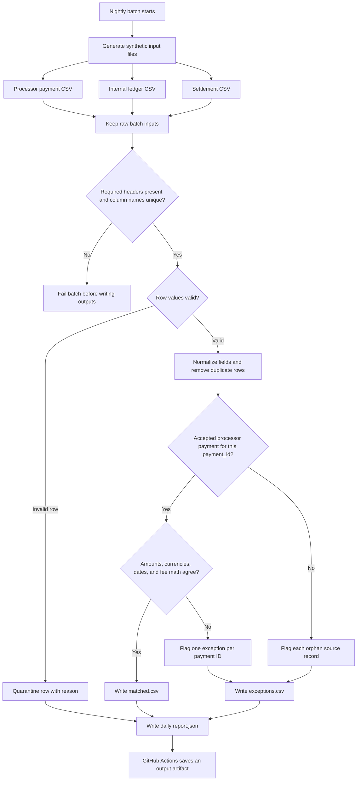

# Payment Reconciliation Pipeline

A small nightly batch pipeline that reconciles synthetic payment processor records, internal ledger entries, and settlement records. It is designed to show the core data engineering work clearly: contracts, validation, deduplication, deterministic matching, exceptions, repeatable runs, and a daily report.

**All records are synthetic.** This project does not connect to a fintech company, process real payments, or use AI.

## Architecture



## What the batch does

1. Creates three repeatable CSV inputs for a batch date.
2. Checks required headers and validates required values, dates, currencies, and integer amounts. Missing required headers or repeated column names stop the batch before it writes reconciliation outputs. Invalid individual rows go to quarantine.
3. Trims whitespace, uppercases currency codes, and removes identical normalized rows within each source.
4. Matches records by `payment_id` and checks payment and ledger amounts, currency agreement, settlement date, and `gross_minor - fee_minor = net_minor`.
5. Flags each accepted ledger or settlement record whose `payment_id` has no accepted processor payment in the batch.
6. Writes matched records, exceptions, quarantined rows, and a JSON quality report.

The synthetic inputs include clean matches, a missing ledger entry, a missing settlement, settlement gross and currency mismatches, inconsistent fee arithmetic, a late settlement, an exact redelivery, a malformed payment row, and one orphan record from each of the ledger and settlement sources.

Matching is deterministic. Missing, ambiguous, late-dated, and mismatched records receive named exception reasons for review. The pipeline does not guess a match.

## Data contracts

| Input | Record grain | Required fields |
| --- | --- | --- |
| `payments.csv` | One processor payment | `payment_id`, `event_date`, `amount_minor`, `currency` |
| `ledger.csv` | One ledger entry | `ledger_entry_id`, `payment_id`, `posting_date`, `amount_minor`, `currency` |
| `settlements.csv` | One settlement record | `settlement_id`, `payment_id`, `settlement_date`, `gross_minor`, `fee_minor`, `net_minor`, `currency` |

`payment_id` is the shared matching key. Amounts are integer minor units; the generator uses USD and EUR, which both have two decimal places. After whitespace is trimmed, source dates must be valid calendar dates in `YYYY-MM-DD` form. Other formats, including `YYYYMMDD` and ISO week dates, send the row to quarantine with `invalid_<field>`. Column names must be unique, including any extra columns. Extra named columns are ignored during reconciliation.

An orphan is a validated, deduplicated ledger or settlement row whose `payment_id` is absent from the validated payments for that batch. Its source record ID comes from `ledger_entry_id` or `settlement_id`. The CSV row number identifies the input location retained after deduplication.

## Outputs

Each run writes under `data/output/<batch-date>/`:

- `matched.csv` — payments that passed every matching rule.
- `exceptions.csv` — `exception_grain=payment` gives one row per payment ID with reconciliation reasons and its payment amount and currency. `exception_grain=source_record` gives one row per orphan with reason `orphan_source_record`, `source`, `source_record_id`, `source_row`, and `source_currency`. Ledger orphans fill `source_amount_minor`. Settlement orphans fill `source_gross_minor`, `source_fee_minor`, and `source_net_minor`. Fields that do not apply are blank.
- `quarantine.csv` — invalid source rows and their validation reasons.
- `report.json` — source counts, duplicates removed, match counts, exception and quarantine counts by reason, and matched and unmatched payment totals by currency. `exception_count` includes both `payment_exception_count` and `orphan_source_exception_count`. `orphan_source_totals_by_source_and_currency` groups ledger `amount_minor` and settlement `gross_minor`, `fee_minor`, and `net_minor` by source and currency. Unmatched payment totals use only payment-grain exceptions.

Generated inputs are kept under `data/raw/<batch-date>/`. Both data directories are ignored by Git. Running the same batch date regenerates the same synthetic rows and replaces that date's local files; it does not append duplicate output.

## Run locally

Requires Python 3.12 or newer. The pipeline uses only the Python standard library; no package installation is needed.

```bash
python -m payment_reconciliation --batch-date 2026-11-23
```

Omit `--batch-date` to use the computer's local date:

```bash
python -m payment_reconciliation
```

The command prints a short summary. Open the CSV files and `report.json` in the matching `data/output/<batch-date>/` folder to inspect the results.

## Nightly automation

`.github/workflows/nightly-reconciliation.yml` runs the synthetic batch daily at midnight in the Philippines (16:00 UTC) and can also be started manually from the Actions tab. GitHub scheduled runs use UTC and may be delayed during busy periods, so this is a portfolio demonstration rather than a guaranteed production schedule. The workflow uploads the report files as an artifact for seven days; it does not commit generated data to the repository.

## Repository structure

```text
.
├── .github/
│   └── workflows/
│       └── nightly-reconciliation.yml
├── payment_reconciliation/
│   ├── __init__.py
│   ├── __main__.py
│   ├── cli.py
│   ├── generator.py
│   └── pipeline.py
├── .gitignore
└── README.md
```

## Scope and limitations

- Every row is synthetic; generated exception rates do not describe real fintech operations.
- The demo models successful payment captures only and matches on an exact shared `payment_id`.
- No FX conversion, provider API, warehouse, dashboard, or cross-day lookback for late arrivals is implemented. A settlement dated after the current batch date is flagged for review.
- Fee validation checks the arithmetic relationship between gross, fee, and net. There is no provider-specific fee schedule to compare against.
- The exception CSV is a review queue, not a user interface or an automated approval process.
- The scheduled workflow has no alerting or production SLA. Automated tests are a later milestone; the first version demonstrates the runnable data flow and row-level checks.

AI is intentionally out of scope. The matching rules are visible and explainable, which is the right baseline before considering any model-assisted exception triage.

## README references

These public data engineering project READMEs informed the organization of this document. Their wording and implementation were not copied:

- [AWS Ecommerce Data Platform](https://github.com/5H13LD2/aws-rds-pipeline)
- [Financial transaction data pipeline](https://github.com/Adetlo/txn-data-pipeline)
- [Data quality reconciliation framework](https://github.com/KiranReddy-data/data-quality-reconciliation-framework)

